# Agentic Learning (V0)

Service à part, sur sa propre instance Vercel (`app-agentic-learning`, équipe datarockstars), qui répond aux questions des apprenants **à partir du seul contenu du LMS DATAROCKSTARS** (aide, explication, indice), avec des citations vérifiées ou un refus motivé, et qui propose de l'autocomplétion de code.

- Modèles open source légers exécutés **dans la fonction**, sur CPU (onnxruntime-node, `@huggingface/transformers` v3), sans aucune API externe :
  - rédaction : `onnx-community/Qwen2.5-0.5B-Instruct` (int8) ;
  - autocomplétion : `onnx-community/Qwen2.5-Coder-0.5B-ONNX`, modèle de **base** (remplissage au milieu, FIM), int8 ;
  - vecteurs : `Xenova/multilingual-e5-small` (q8).
- Architecture inspirée de l'« Agentic Knowledge Graph Engine » : ancrage hybride, ontologie, graphe CSR, échelle de refus, tri sémantique, validation des citations, construction hors ligne **sans modèle génératif**.

La documentation produit (vision, sécurité, exploitation…) est dans [docs/](docs/) ; la vitrine et la démo Studio sont dans `public/`. Ce README décrit le moteur V0 tel qu'il est codé.

## Architecture

```mermaid
flowchart LR
  subgraph HL["Hors ligne (scripts/, Node, sans modèle génératif)"]
    DB[("Base de prod du LMS<br/>SELECT seulement")] --> EX["exporter.ts<br/>transaction read only"]
    EX --> XT["extraction<br/>BlockNote + widgets JSON<br/>solutions exclues"]
    XT --> DC["découpe<br/>80 à 220 mots"]
    DC --> ON["ontologie<br/>rubrique › cours › module › leçon<br/>+ concepts, synonymes FR-EN"]
    DC --> BM["BM25<br/>racinisation légère"]
    DC --> VE["vecteurs e5<br/>« passage: » → int8"]
    ON --> CSR["graphe CSR<br/>contient, mentionne,<br/>prérequis, cooccurrence"]
    BM & VE & CSR & ON --> MF["data/index/ + manifeste<br/>(comptes, date, modèles, SHA-256)"]
  end
  subgraph RT["Exécution (fonction Vercel /api/ask)"]
    Q["prise en charge<br/>normalisation, mode, contexte"] --> AL["agent lexical<br/>BM25 top 50"] & AD["agent dense<br/>e5 « query: » top 50"]
    AL & AD --> RRF["fusion RRF k = 60<br/>bonus cours / leçon<br/>filtre cours autorisés"]
    Q --> LC["lien vers les concepts"] --> BFS["chemins CSR<br/>BFS ≤ 2 sauts"]
    RRF & BFS --> TRI["tri sémantique"]
    TRI --> P15["portes 1 à 5<br/>en parallèle"]
    P15 -->|ouvertes| RED["rédaction Qwen 0,5 B<br/>consigne stricte"]
    P15 -->|fermée| REF["refus motivé"]
    RED --> VC["validation des citations [n]"] --> P6["porte 6<br/>vérification phrase à phrase"]
    P6 -->|vérifiée| REP["réponse citée"]
    P6 -->|échec| EXT["réponse extractive"] -.->|rien d'extractible| REF
  end
  MF -.-> RT
  C1[("cache LRU<br/>chemins")] -.-> BFS
  C2[("cache LRU<br/>scores")] -.-> RRF
```



| Bloc | Où | Ce qu'il fait |
|---|---|---|
| Prise en charge | `src/moteur/priseEnCharge.ts` | validation stricte du contrat, nettoyage, termes racinisés, élargissement par synonymes, identifiants du code de l'apprenant, cours autorisés, titre de la leçon en contexte pour une question courte ou creuse |
| Ancrage hybride | `src/moteur/ancrage.ts`, `bm25.ts` | agent lexical BM25 (k1 = 1,2, b = 0,75, top 50) et agent dense e5 (cosinus sur vecteurs int8, top 50) **en parallèle**, fusion RRF (k = 60), bonus × 1,15 au cours en cours et × 1,35 à la leçon en cours, filtre des cours autorisés appliqué pendant le parcours |
| Ontologie | `scripts/construire.ts`, `src/index/types.ts` | rubrique (formation) › cours › module › leçon, plus des concepts : titres, termes en gras, identifiants de code, technos (`src/texte/technos.ts`), groupes de synonymes français-anglais (`src/texte/synonymes.ts`) |
| Lien vers les concepts | `src/moteur/concepts.ts` | n-grammes (1 à 4 termes) de la question, du code et du contexte, ramenés à leur forme canonique |
| Graphe CSR | `src/moteur/csr.ts` | tableaux typés (`offsets`, `cibles`, `types`, `poids`) ; arêtes contient / dans, mentionne / mentionnePar, prérequis / requiert (ordre des leçons d'un cours), cooccurrence pondérée (PMI, 8 voisins au plus) ; BFS de 2 sauts au plus, cache LRU des chemins (2 000 entrées) |
| Tri sémantique | `src/moteur/tri.ts` | 0,40 × cosinus normalisé + 0,20 × RRF + 0,25 × couverture lexicale de la question + 0,15 × proximité dans le graphe ; deux passages au plus par leçon ; en mode indice, aucun passage dont le code ressemble à une solution |
| Échelle de refus | `src/moteur/portes.ts`, `verification.ts` | 6 portes, chacune avec un code et un message en français (tableau ci-dessous) |
| Validation des citations | `src/moteur/citations.ts` | `[1, 2]` → `[1][2]`, numéros hors des passages supprimés, renumérotation dans l'ordre d'apparition, citation corrigée vers le passage qui appuie vraiment la phrase |
| Rédaction | `src/moteur/redaction.ts` | Qwen2.5-0.5B-Instruct, décodage glouton, consigne stricte : français, seulement les extraits, `[n]` après chaque phrase, 120 mots au plus ; en mode indice, ni code ni réponse complète, puis filtre des blocs et lignes de code et des fragments qui recopient une solution connue |
| Caches | `src/moteur/lru.ts` | chemins (2 000), scores d'ancrage par requête (500), découpe des passages en phrases (4 000) |

### L'échelle de refus

Les portes 1 à 5 s'évaluent en parallèle (`Promise.all`, chacune chronométrée) sur l'état commun de l'ancrage ; la porte 6 vérifie le texte rédigé. Le refus renvoyé est celui de la **première porte fermée** dans l'ordre.

| n | Code | Se ferme quand |
|---|---|---|
| 1 | `aucune-entree` | question vide (aucune lettre ni chiffre), aucun cours autorisé connu, aucun candidat, ou aucun mot connu de l'index ni concept ni code, sans passage très proche (cosinus < 0,86) |
| 2 | `trop-vague` | formule creuse (« je comprends pas », « explique-moi »…) sans leçon ni code en contexte, ou mots trop communs (somme des IDF < 3, un seul mot d'IDF < 4) sans concept lié |
| 3 | `hors-programme` | aucun chemin (concept lié → leçon d'un cours autorisé, 2 sauts au plus) vers un passage du top 10 à la fois proche (cosinus ≥ 0,855) et pertinent (couverture ≥ 0,5 ou cosinus ≥ 0,845) ; sans concept lié : aucun passage à cosinus ≥ 0,865 et couverture ≥ 0,5 |
| 4 | `non-citable` | aucun des 5 premiers passages n'a de phrase qui couvre la moitié de la question (ni de passage qui en couvre deux tiers à cosinus ≥ 0,84) |
| 5 | `retire` | la leçon en cours est retirée, ou tout ce qui est citable est retiré (leçon non publiée ou masquée, cours non publié, ou slug listé dans `AGENTIC_RETRAITS`) |
| 6 | `non-verifie` | une phrase rédigée n'est appuyée par aucun passage fourni : inclusion lexicale ≥ 0,6, ou ≥ 0,4 avec cosinus e5 ≥ 0,85 ; si au moins la moitié des phrases sont appuyées, seules celles-ci sont rendues ; sinon **réponse extractive** (phrases du cours, citées) et, s'il n'y a rien à extraire, refus |

Les seuils sont dans `SEUILS` (`portes.ts`) et `SEUILS_VERIF` (`verification.ts`), calibrés sur la première partie de `eval/questions.json` ; les questions marquées `controle` ont été ajoutées après ce réglage.

## Construction de l'index (hors ligne)

```bash
npm install                 # Node 24 ; ONNXRUNTIME_NODE_INSTALL_CUDA=skip conseillé
npm run modeles             # modèles ONNX dans models/ (révisions épinglées, tailles et SHA-256 contrôlés)
npm run index               # = exporter + construire
```

1. **Export** (`scripts/exporter.ts`) : une seule transaction `BEGIN READ ONLY`, uniquement des `SELECT`, avec `DATABASE_URL` lue par `--env-file=$HOME/Workspace/lms/.env.vercel-prod.local` (jamais affichée, même dans les erreurs). On exporte les cours publiés hors corbeille, leurs modules, les placements (`module_lessons`), les leçons (contenu seulement si publiées), les consignes de labs (sans script de contrôle, sans solution, sans indice), les notebooks (titre et résumé). Les solutions d'exercices et de labs ne sortent de la base que sous forme d'**empreintes** (fragments de 6 jetons hachés, irréversibles). Sortie : `data/export/lms.json` (local, jamais déployé).
2. **Extraction** (`scripts/lib/extraction.ts`) : le contenu est un document BlockNote ; ses blocs de code portent soit du vrai code (`python`, `sql`…), soit un composant JSON (```etapes, ```decision, ```lab-etape… : le « Markdown à widgets » du LMS). On garde le texte utile ; on **exclut** solutions, corrigés, bonnes réponses, révélations, retours sur les choix, pistes, indices, explications de corrigé, vérifications et blocs `python-solution`. Les composants d'évaluation (exercices, quiz, prédiction, décision, réflexion) ne gardent que leur question.
3. **Découpe** en passages de 80 à 220 mots, avec le chemin de titres et les ids cours, module, leçon.
4. **Ontologie, BM25, graphe CSR, vecteurs e5** (int8, une échelle par vecteur ; cache local `data/cache/` pour ne réencoder que les passages modifiés).
5. **Manifeste** `data/index/manifeste.json` : comptes, dates, modèle des vecteurs, taille et SHA-256 de chaque fichier (vérifiés au chargement).

Index du 07/11/2026 : 43 cours, 667 modules, 2 809 leçons publiées (28 retirées connues par leur titre), 14 197 passages (93,9 % entre 80 et 220 mots, 147 mots en moyenne), 32 193 concepts, 471 172 arêtes, 26 006 termes, 31 Mo.

## Exécution

```bash
npm test                    # tests unitaires (node:test via tsx)
npm run typecheck
npm run serveur             # http://localhost:3210 (mêmes gestionnaires que Vercel, secret de .env.local)
npm run evaluer             # évaluation de bout en bout (vrais modèles), résultats dans eval/resultats.json
```

`.env.local` (ignoré par git) contient `AGENTIC_SECRET`, généré par `openssl rand -hex 32`. Variables facultatives : `AGENTIC_RETRAITS` (slugs de leçons à retirer à chaud), `AGENTIC_ECHEANCE_REDACTION_MS` (60 000 par défaut), `AGENTIC_RACINE`, `AGENTIC_INDEX`.

### Vercel

- `vercel.json` : `api/ask.ts` et `api/complete.ts` en mémoire 3009 et `maxDuration` 120, `includeFiles` pour l'index et le seul modèle utile à chaque fonction, binaires onnxruntime des autres plateformes exclus ; `public/` servi en statique.
- Build : `npm run build` télécharge les modèles (révisions épinglées, ≈ 1,1 Go, tailles et SHA-256 vérifiés) et échoue si l'index manque. L'index est construit en local et envoyé avec le déploiement (`data/index/`) ; l'export brut, le cache et les modèles ne le sont jamais (`.vercelignore`, `scripts/deploy.sh`).
- Taille estimée des fonctions : `ask` ≈ 750 Mo, `complete` ≈ 600 Mo, `sante` < 5 Mo. Au-delà de 250 Mo, il faut les « large functions » (5 Go au plus ; actives par défaut sur un projet neuf, sinon `VERCEL_SUPPORT_LARGE_FUNCTIONS=1`). Avec Fluid Compute, la mémoire se règle dans le tableau de bord (la clé `memory` de `vercel.json` y est signalée par un avertissement).
- Déploiement : `bash scripts/deploy.sh` (copie sans `.git`, projet `app-agentic-learning`, équipe datarockstars). **Pas encore lancé** : ni projet Vercel créé, ni déploiement.

## Contrat d'API

Authentification : `Authorization: Bearer <AGENTIC_SECRET>` sur tout sauf `/api/sante`, comparaison à temps constant (empreintes SHA-256). Sans secret configuré (ou secret de moins de 32 caractères), tout est refusé. Corps limités à 32 Ko (`ask`) et 16 Ko (`complete`) ; au-delà : 413. Entrée invalide : 400 `{ erreur: { code, message } }`. Aucun texte d'apprenant dans les journaux (route, statut, porte, durée seulement).

### POST /api/ask

Entrée :

```json
{ "question": "≤ 500 caractères", "cours": "slug?", "lecon": "slug?", "code": "≤ 4000 caractères ?", "mode": "aide | indice | explique", "autorises": ["slug-de-cours"] }
```

`autorises` est obligatoire (`"tous"` ou une liste de slugs) ; `mode` vaut `aide` s'il est absent.

Sortie :

```json
{
  "statut": "reponse | refus",
  "texte": "…",
  "citations": [{ "n": 1, "cours": "apprendre-sql", "coursTitre": "Apprendre SQL", "lecon": "sql-ch06-l02", "titre": "LEFT JOIN et RIGHT JOIN", "extrait": "≤ 280 caractères", "url": "/cours/apprendre-sql/sql-ch06-l02" }],
  "refus": { "porte": 3, "code": "hors-programme", "message": "…" },
  "trace": { "portes": [{ "n": 1, "nom": "aucune-entree", "ok": true, "ms": 0.02 }], "modele": "Qwen2.5-0.5B-Instruct@22942cb (int8) | extractif | aucun", "ms": 2140 }
}
```

`refus` n'est présent qu'avec `statut: "refus"` (alors `texte` = message et `citations` = []). `trace.portes` contient les portes 1 à 5 (toujours évaluées) et la porte 6 quand une rédaction a eu lieu. `modele` vaut `extractif` quand la porte 6 a rejeté la rédaction et que la réponse est faite de phrases du cours. Le cours cité est le cours en cours s'il contient la leçon, sinon le premier cours autorisé qui la contient.

### POST /api/complete

Entrée : `{ "langage": "python", "avant": "≤ 2000", "apres": "≤ 1000", "cours": "slug?", "lecon": "slug?" }`
Sortie : `{ "suggestion": "≤ 200 caractères", "modele": "Qwen2.5-Coder-0.5B-ONNX@c0bbc5c (int8)", "ms": 640 }`

FIM `<|fim_prefix|>avant<|fim_suffix|>apres<|fim_middle|>`, 48 jetons au plus, arrêt à la première ligne vide, recouvrement avec `apres` retiré. Passé 4 s (chargement à froid compris), la suggestion est vide ; le chargement continue en arrière-plan pour l'appel suivant. Le titre de la leçon est ajouté en commentaire quand le code est court.

### GET /api/sante

`{ "ok": true, "index": { "lecons", "passages", "concepts", "aretes", "construitLe" }, "modeles": [{ "role", "nom" }] }` — sans aucun contenu, sans secret, ne lit que le manifeste.

## Évaluation

`npm run evaluer` passe par les gestionnaires HTTP de `api/` avec les vrais modèles sur CPU (MacBook M1 Pro). Voir « Résultats » ci-dessous et `eval/resultats.json` (non versionné).

### Résultats (07/11/2026, MacBook M1 Pro, CPU)

| Mesure | Ensemble (48 + 20 questions) | Contrôle (10 + 6, ajoutées après le réglage) |
|---|---|---|
| Précision des refus (refus justifiés / refus) | 0,952 (20/21) | 0,857 (6/7) |
| Rappel des refus (hors programme refusées) | 1,000 (20/20) | 1,000 (6/6) |
| Faux refus dans le programme | 1 (porte 4, « noyau de Jupyter qui plante ») | 1 |
| Citations valides (numéros cohérents, URL, leçon placée dans le cours, extrait tiré de la leçon) | 100 % (47/47) | 100 % (9/9) |
| Leçon attendue dans le top 3 du tri sémantique | 100 % (48/48) | 100 % (10/10) |
| Leçon attendue parmi les 3 premières citations | 83 % (40/48) | 80 % (8/10) |
| Réponses rédigées vérifiées / extractives | 6 / 41 | 1 / 8 |

Refus par porte : 18 hors-programme, 1 aucune-entree (question vide), 1 trop-vague (« je comprends pas »), 1 non-citable.

| Latence | à froid (chargement du modèle) | p50 | p95 |
|---|---|---|---|
| POST /api/ask | 11,7 s | 1,9 s | 8,6 s |
| POST /api/complete | 4,0 s (suggestion vide, échéance) | 0,67 s | 1,6 s |

Autocomplétion : 12 suggestions non vides sur 16 (exemples : `print(fruit)`, `ON c.id = co.client_id`, `nom + " " + str(age)`, `self.titre = titre…`).


## Limites et problèmes ouverts

- **Rédaction faible** : Qwen2.5-0.5B rédige souvent hors des extraits (confusions, hallucinations) ; la porte 6 les rejette et la réponse devient extractive. La sécurité est tenue, la fluidité non : un modèle de 1,5 B, ou une rédaction guidée phrase par phrase, est la prochaine étape.
- **Vérification par similarité** : inclusion lexicale et cosinus ne voient ni la négation ni les antonymes (« trop simple » / « trop souple ») ; un vrai modèle d'implication (NLI) multilingue léger serait plus sûr.
- **Seuils calibrés sur peu de questions** (48 dans le programme, 20 hors programme, dont 16 de contrôle) : à recalibrer sur de vraies questions d'apprenants, par cours.
- **Retraits** : une leçon dépubliée après la construction reste dans l'index jusqu'à la prochaine construction, sauf si son slug est dans `AGENTIC_RETRAITS`.
- **Notebooks** : seuls leur titre et leur résumé sont indexés (les `.ipynb` sont dans Vercel Blob, non exportés).
- **CPU de Vercel** : les latences mesurées sur M1 Pro seront plus longues sur 1,7 vCPU x86 ; le premier appel d'une instance charge le modèle (quelques secondes).
- **Taille des fonctions** : > 250 Mo, donc « large functions » obligatoires ; à vérifier au premier déploiement, comme l'avertissement sur `memory` avec Fluid Compute.
- **Article d'inspiration** non lisible (accès refusé, page payante) : l'architecture suit la liste des blocs fournie.

## Structure

```
api/            ask.ts, complete.ts, sante.ts (gestionnaires Web GET/POST) ; studio.ts (démo, conversation produit)
src/http.ts     secret à temps constant, corps bornés, journal sans contenu
src/moteur/     priseEnCharge, ancrage (BM25 + dense + RRF), concepts, csr, tri, portes, citations, verification, redaction, repondre, completer, lru
src/index/      format (types), conteneur binaire, chargement et vérification des empreintes
src/modeles/    catalogue (révisions épinglées) et chargement transformers.js (env.allowRemoteModels = false)
src/texte/      normalisation, racinisation, synonymes, technos, phrases, empreintes de code
scripts/        exporter, construire (+ lib/extraction), telecharger-modeles, evaluer, serveur-local, deploy.sh
test/           tests unitaires (BM25, CSR, portes, citations, extraction, API)
eval/           questions.json (jeu d'évaluation)
data/, models/  générés, ignorés par git
docs/, public/  documentation produit, vitrine et Studio (conversation produit)
```
